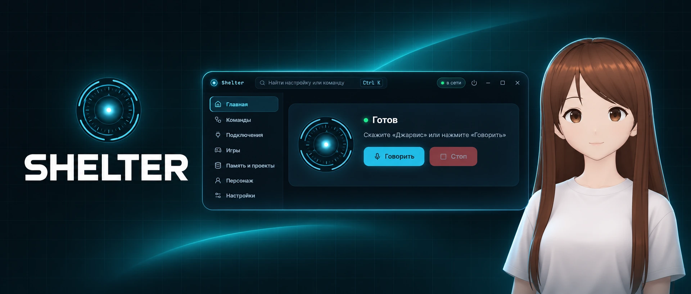
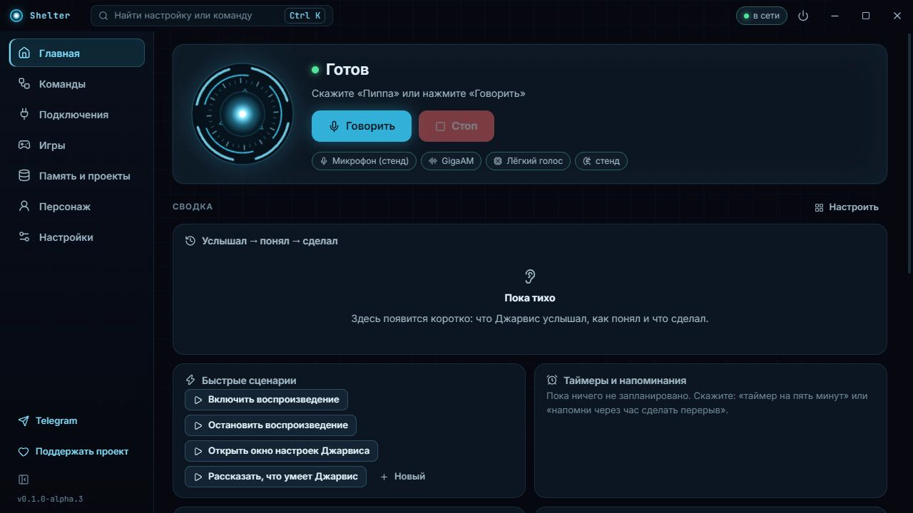
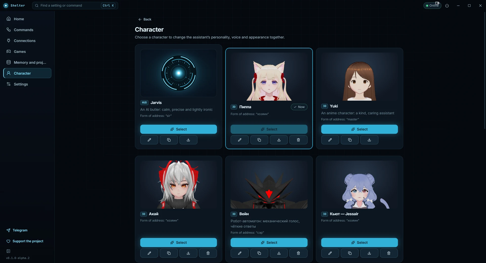

# Shelter



Голосовой ассистент для компьютера и телефона. Открывайте приложения, управляйте музыкой, ставьте напоминания, запускайте сценарии и разговаривайте с выбранной моделью. На ПК можно сказать «Джарвис» или нажать «Говорить».

[Установка](#установка) · [Что умеет](#что-умеет) · [Telegram IT Shelter](https://t.me/+tqB8b6h4JbYwZWVi) · [Поддержать проект](https://t.me/itshelter_bot?start=donate)

## Установка

Версия `0.1.0-alpha.2`. У каждой сборки свои возможности и требования.

| Платформа | Пакет | Первый запуск |
| --- | --- | --- |
| **Windows 10/11 x64** | Установщик `Shelter-0.1.0-alpha.2-windows-x64-setup.exe` | Выберите папку. Мастер поможет скачать компоненты распознавания и голоса. |
| **Linux x86_64** | Архив `Shelter-0.1.0-alpha.2-linux-x86_64.tar.gz` | Распакуйте и запустите `python3 tools/install_linux.py`. Графическая оболочка использует GTK и WebKitGTK. См. [инструкцию для Linux](docs/LINUX.md). |
| **Android 8+** | `Shelter` | Облачная беседа, простые команды и подключение к своему ПК. |
| **Android 12+** | `Shelter Local` | Всё из обычной сборки и отдельная загрузка модели для беседы на устройстве. |

Модели скачиваются отдельно. Для Android в комплекте релиза есть
устанавливаемые тестовые APK и сборки Release для подписи издателя.
[Подробнее про Android](docs/ANDROID_CLIENT.md).

## Что умеет

- **Голос и текст.** Русское распознавание на ПК через GigaAM или Vosk, голосовой ответ и прерывание. Приложение на русском и английском.
- **Действия на компьютере.** Программы, окна, громкость, музыка, таймеры, диктовка и редактирование выделенного текста.
- **Сценарии.** Собирайте цепочки действий, вызывайте их голосом или запускайте по расписанию. [Примеры](docs/SCENARIOS.md).
- **Модели и проекты.** Выбирайте локальные или облачные модели для чата, зрения, голоса и изображений. История, память и материалы проектов управляются в приложении. [Подключение моделей](docs/CLOUD_MODELS.md).
- **Игры.** Напарник Minecraft Java Edition с задачами и игровым инвентарём на поддерживаемых серверах, производство Factorio и помощь в кампании Hearts of Iron IV. [Совместимость игр](docs/GAMES.md).
- **Подключения.** Умный дом, OBS, Telegram, MCP и управление своим ПК с телефона.

## Интерфейс



## Персонажи

Джарвис и Юки — пресеты с разными именами вызова, голосами и характером.
Можно настроить свой пресет и импортировать VRM. На кадре ниже открыта
настоящая панель проекта, Юки показана с подключённой VRM-моделью.



Модель в карточке Юки — VRM1_Constraint_Twist_Sample © 2022 pixiv Inc.
[Условия использования](THIRD_PARTY.md).

## Собрать из исходников

Для Windows понадобятся Python 3.11, Node.js 22.12+, Rust, MSVC Build Tools и WebView2.

```powershell
python -m venv .venv
.venv\Scripts\python -m pip install -r requirements-lock.windows.txt
npm --prefix app ci
npm --prefix app run desktop:build
```

Запустите `app/src-tauri/target/release/Jarvis.exe`. Имя исполняемого файла
сохраняет совместимость с прежними локальными запусками, а само окно и
установщик называются Shelter. Для сборки установщика используйте
`npm --prefix app run desktop:bundle`.

[Разработка](docs/DEVELOPMENT.md) · [Платформы](docs/PLATFORMS.md) ·
[Расширения](docs/PLUGINS.md) · [Вклад в проект](CONTRIBUTING.md)

## Данные и лицензия

Локальное распознавание выполняется на устройстве. Сетевые действия, такие как
поиск, погода и запросы к облачной модели, обращаются к выбранным сервисам.
Личные модели, голоса, ключи и рабочие данные доступны в папке установки.

Код проекта распространяется по [MIT](LICENSE). У сторонних компонентов
свои условия. [Атрибуция и лицензии](THIRD_PARTY.md).

## English overview

Shelter is a voice-first assistant for Windows, Linux and Android. It runs
desktop commands and workflows, connects to local or cloud models, and supports
custom personas and game integrations. Windows is the main desktop target
and Linux support is experimental. The interface is available in English
and Russian.
