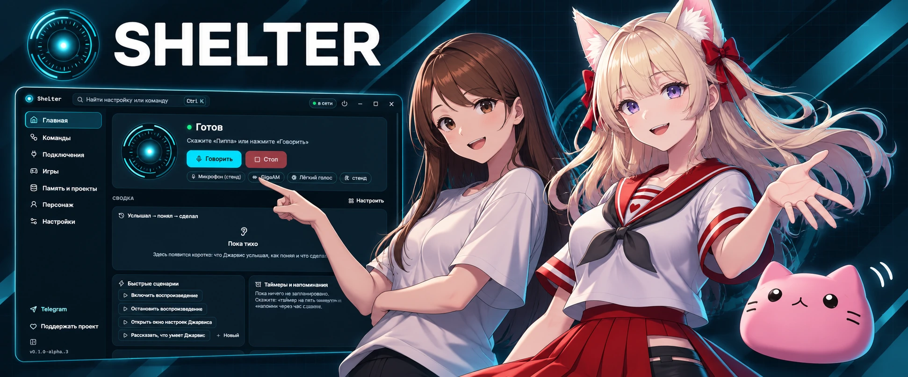
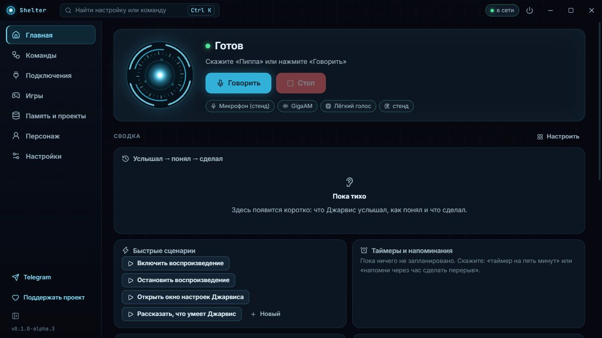
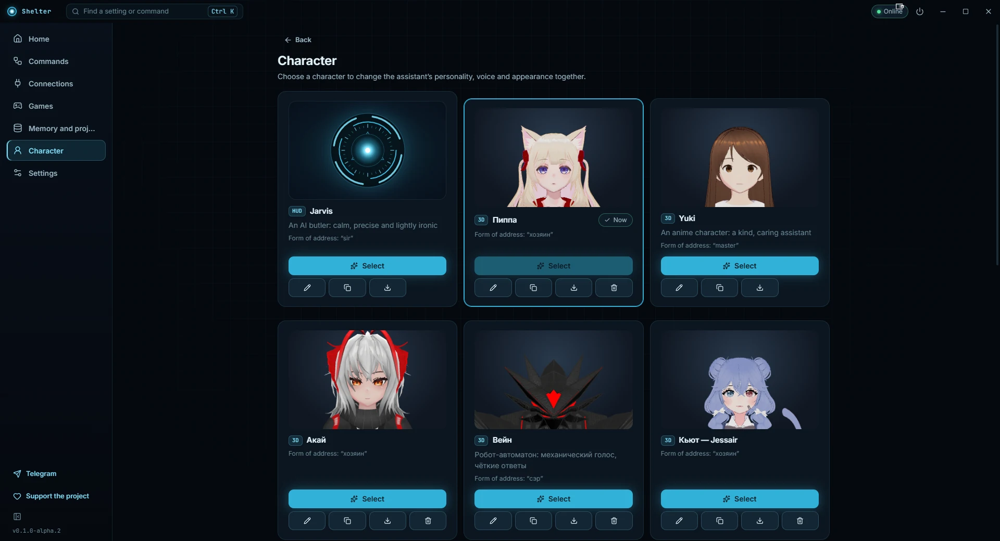
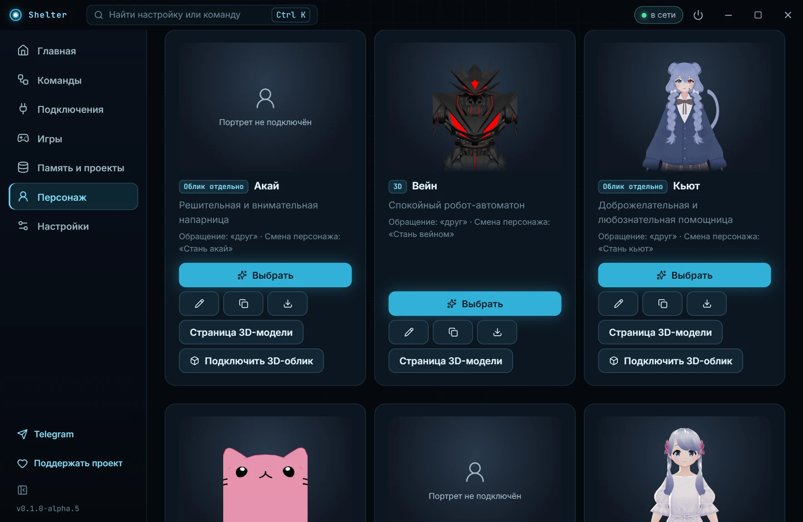

# Shelter

[English](../../README.md) · [Русский](../ru/README.md) · **日本語** · [简体中文](../zh-CN/README.md)



Shelter は Windows、Linux、Android 向けのオープンソース音声アシスタントです。アプリの起動、音楽の操作、リマインダーの設定、ワークフローの実行、ローカルモデルやクラウドモデルとの会話ができます。デスクトップでは、選択中のキャラクターの呼びかけ名をロシア語で発音するか、**Speak**（話す）を押します。

[ダウンロード](https://github.com/IT-Shelter-Labs/shelter/releases) · [利用・開発ガイド](GUIDE.md) · [IT Shelter の Telegram](https://t.me/+tqB8b6h4JbYwZWVi) · [プロジェクトを支援](https://t.me/itshelter_bot?start=donate)

## インストール

| プラットフォーム | パッケージ | 初回設定 |
| --- | --- | --- |
| **Windows 10/11 x64** | `Shelter-<version>-windows-x64-setup.exe` | インストーラーを実行し、セットアップ画面で音声用のコンポーネントを取得します。 |
| **Linux x86_64** | `Shelter-<version>-linux-x86_64.tar.gz` | 展開して `python3 tools/install_linux.py --light-recognition` を実行します。Linux 対応は実験段階です。 |
| **Android 8 以降** | **Shelter**（Companion APK） | クラウドで会話するか、スマートフォンを PC の Shelter とペアリングします。 |
| **Android 12 以降** | **Shelter Local**（Local APK） | 端末内のモデルでも会話できます。対応するモデルはアプリからダウンロードできます。 |

テスト用 APK はデバッグ鍵で署名されています。モデルの重みは別途ダウンロードします。必要な環境と初回設定は[ガイド](GUIDE.md)をご覧ください。

## 主な機能

- **音声とテキスト。** デスクトップでは GigaAM または Vosk によるロシア語の音声認識に対応しています。応答の読み上げや処理の中止もできます。
- **PC 操作とワークフロー。** アプリの起動、メディア・音量の操作、テキストの編集が可能です。ボタン、音声、スケジュール、イベントからワークフローを実行できます。
- **モデルとプロジェクト。** 会話、複雑なタスク、画面の理解、読み上げ、画像生成に使うモデルを個別に選べます。会話履歴、メモリ、プロジェクト資料もアプリ内で管理できます。
- **ゲーム。** 対応する Minecraft Java Edition のワールドに仲間を接続できます。Factorio のクラフト進捗の確認や Hearts of Iron IV のキャンペーン支援・画面解析にも対応しています。
- **外部連携。** スマートフォン、スマートホーム、OBS、Telegram、MCP、拡張機能を接続できます。

アプリの表示言語はロシア語と英語です。日本語版と中国語版はドキュメントをご利用ください。

## デスクトップ画面とキャラクター



デスクトップ版には 10 種類のプリセットがあります。初回起動時は **ピッパ** が選択されています。ジャーヴィス、ユキ、アカイ、ヴェイン、マンジュ、つくよみちゃん、キュート、ヤマネコ、ミクも利用できます。キャラクターごとに呼びかけ名、声、性格が変わり、更新後も選択は引き継がれます。





マンジュの 3D モデルは同梱されています。ユキを選ぶと pixiv のモデルをダウンロードします。ピッパにはポートレートと作者の VRM 配布ページへのリンクがあります。[キャラクターの設定](GUIDE.md) · [素材クレジット](THIRD_PARTY.md)

## ソースからビルド

Windows では Python 3.11、Node.js 22.12 以降、Rust、MSVC Build Tools、WebView2 が必要です。リポジトリのルートで PowerShell を開き、次のコマンドを実行します。

```powershell
python -m venv .venv
.\.venv\Scripts\python.exe -m pip install -r requirements-lock.windows.txt
$env:Path = "$(Resolve-Path .\.venv\Scripts);$env:Path"
npm --prefix app ci
npm --prefix app run desktop:build
```

`app/src-tauri/target/release/Jarvis.exe` を起動します。互換性のため、実行ファイル名は以前と同じです。Windows のインストーラーは `npm --prefix app run desktop:bundle` で作成できます。

| ディレクトリ | 内容 |
| --- | --- |
| `shelter_core/` | 音声処理、モデル、操作、連携を担う Python コア |
| `app/`、`native/`、`hud/` | Svelte と Tauri のデスクトップ版、ネイティブ音声処理、Windows HUD |
| `android/` | 2 種類の Android 版の Kotlin 実装 |
| `personas/` | 組み込みプリセットと配布可能な画像 |
| `minecraft/`、`games/` | ゲームクライアント、アダプター、Mod |
| `tests/`、`tools/`、`docs/` | テスト、ビルドツール、ドキュメント |

[ビルド、テスト、開発への参加](GUIDE.md)

## データとライセンス

ローカル音声認識は端末内で実行されます。検索、天気、クラウドモデルなどの機能は、必要なリクエストを選択したサービスへ送信します。公開用ソースのエクスポートからは、ローカルモデル、音声サンプル、認証情報、プロジェクトデータが除外されます。

Shelter のコードは [MIT ライセンス](../../LICENSE)で公開されています。サードパーティのコードや素材には個別の利用条件があります。[サードパーティのライセンス](THIRD_PARTY.md)
