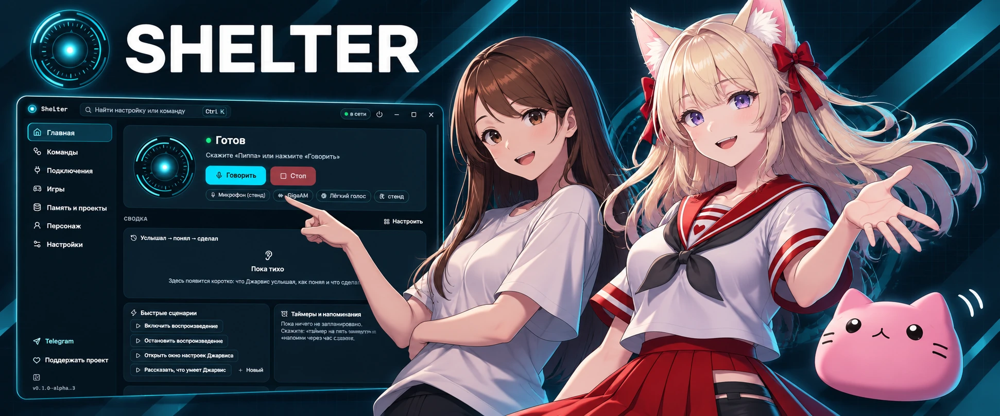
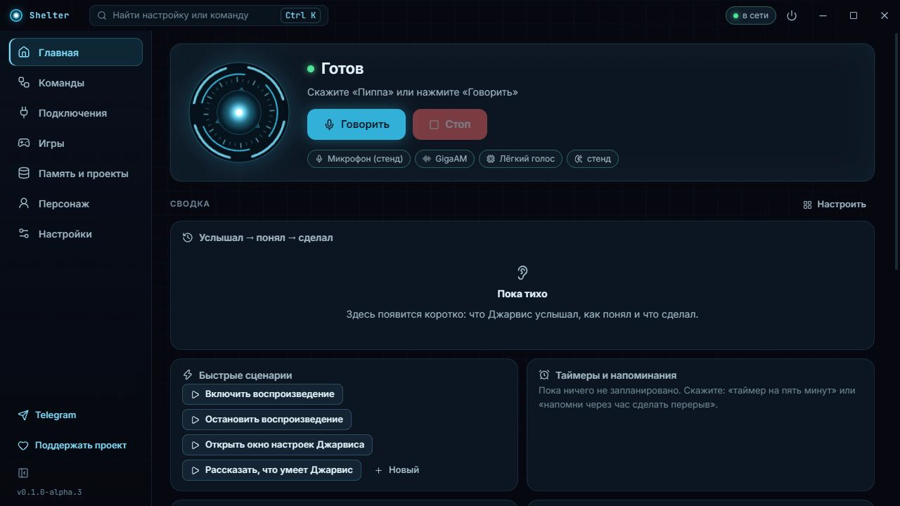
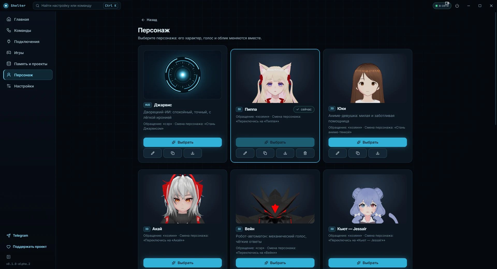
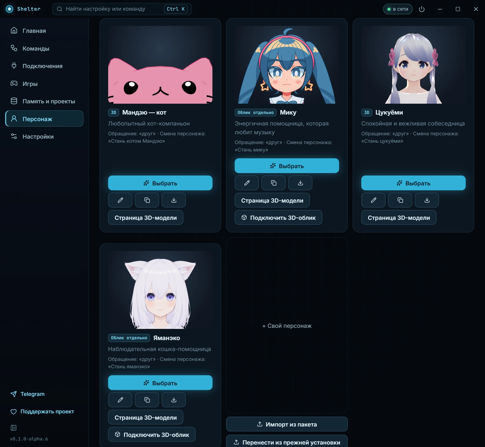

# Shelter

[English](../../README.md) · **Русский** · [日本語](../ja/README.md) · [简体中文](../zh-CN/README.md)



<p align="center">
  <a href="https://github.com/IT-Shelter-Labs/shelter/releases/download/v0.1.0-alpha.6/Shelter-0.1.0-alpha.6-windows-x64-setup.exe"></a>
  <a href="https://github.com/IT-Shelter-Labs/shelter/releases/download/v0.1.0-alpha.6/Shelter-0.1.0-alpha.6-linux-x86_64.tar.gz"></a>
  <a href="https://github.com/IT-Shelter-Labs/shelter/releases/download/v0.1.0-alpha.3/Shelter-0.1.0-alpha.3-android-companion-test.apk"></a>
  <a href="https://github.com/IT-Shelter-Labs/shelter/releases/download/v0.1.0-alpha.3/Shelter-0.1.0-alpha.3-android-local-test.apk"></a>
</p>

[Архив игровых модов](https://github.com/IT-Shelter-Labs/shelter/releases/download/v0.1.0-alpha.3/Shelter-0.1.0-alpha.3-game-mods.zip) · [Веса голоса Джарвиса v4](https://github.com/IT-Shelter-Labs/shelter/releases/download/v0.1.0-alpha.5/Shelter-Jarvis-voice-v4.safetensors) · [Все выпуски](https://github.com/IT-Shelter-Labs/shelter/releases)

Голосовой ассистент с открытым исходным кодом для Windows, Linux и Android. Открывайте приложения, управляйте музыкой, ставьте напоминания, запускайте сценарии и разговаривайте с выбранной моделью. На ПК можно произнести по-русски имя выбранного персонажа или нажать «Говорить».

[Руководство](GUIDE.md) · [Персонажи](#персонажи) · [Telegram IT Shelter](https://t.me/+tqB8b6h4JbYwZWVi) · [Поддержать проект](https://t.me/itshelter_bot?start=donate)

## Установка

Пакеты публикуются на [странице выпусков](https://github.com/IT-Shelter-Labs/shelter/releases).

| Платформа | Пакет | Первый запуск |
| --- | --- | --- |
| **Windows 10/11 x64** | Установщик `Shelter-<версия>-windows-x64-setup.exe` | Выберите папку. Мастер поможет скачать компоненты распознавания и голоса. |
| **Linux x86_64** | Архив `Shelter-<версия>-linux-x86_64.tar.gz` | Распакуйте и запустите `python3 tools/install_linux.py`. Графическая оболочка использует GTK и WebKitGTK. Поддержка Linux экспериментальная. См. [инструкцию для Linux](../LINUX.md). |
| **Android 8+** | `Shelter` | Облачная беседа, простые команды и подключение к своему ПК. |
| **Android 12+** | `Shelter Local` | Всё из обычной сборки и отдельная загрузка модели для беседы на устройстве. |

Модели скачиваются отдельно. Тестовые APK подписаны отладочным ключом.
[Подробнее про Android](../ANDROID_CLIENT.md).

## Что умеет

- **Голос и текст.** Русское распознавание на ПК через GigaAM или Vosk, голосовой ответ и прерывание. Интерфейс доступен на русском и английском. Японский и китайский доступны в документации.
- **Действия на компьютере.** Программы, окна, громкость, музыка, таймеры, диктовка и редактирование выделенного текста.
- **Сценарии.** Собирайте цепочки действий, вызывайте их голосом или запускайте по расписанию. [Примеры](../SCENARIOS.md).
- **Модели и проекты.** Выбирайте локальные или облачные модели для чата, зрения, голоса и изображений. История, память и материалы проектов управляются в приложении. [Подключение моделей](../CLOUD_MODELS.md).
- **Игры.** Напарник Minecraft Java Edition с задачами и игровым инвентарём на поддерживаемых серверах, производство Factorio и помощь в кампании Hearts of Iron IV. [Совместимость игр](../GAMES.md).
- **Подключения.** Умный дом, OBS, Telegram, MCP и управление своим ПК с телефона.

## Интерфейс



## Персонажи

В настольном Shelter десять пресетов. При первом запуске активен **Джарвис**. Доступны также Пиппа, Юки, Акай, Вейн, Мандзю, Цукуёми, Кьют, Яманэко и Мику. Пресеты меняют имя вызова, голос и характер. Выбор сохраняется после обновления.





На первом скриншоте показана локальная установка с подключёнными 3D-обликами. У каждого встроенного персонажа есть портрет или реактор Джарвиса.

3D-облики Юки, Вейна, Мандзю и Цукуёми входят в комплект. Оригинальный облик Пиппы можно скачать у автора и подключить с её карточки. На совместимой видеокарте NVIDIA установка фирменного голоса скачивает обученный профиль Джарвиса v4 и использует встроенный образец голоса Юки и Пиппы. [Настройка персонажей](GUIDE.md) · [Авторы и лицензии](THIRD_PARTY.md)

## Собрать из исходников

Для Windows понадобятся Python 3.11, Node.js 22.12+, Rust, MSVC Build Tools и WebView2.

```powershell
python -m venv .venv
.\.venv\Scripts\python.exe -m pip install -r requirements-lock.windows.txt
$env:Path = "$(Resolve-Path .\.venv\Scripts);$env:Path"
npm --prefix app ci
npm --prefix app run desktop:build
```

Запустите `app/src-tauri/target/release/Jarvis.exe`. Имя исполняемого файла
сохраняет совместимость с прежними локальными запусками, а само окно и
установщик называются Shelter. Для сборки установщика используйте
`npm --prefix app run desktop:bundle`.

[Сборка, проверки и вклад в проект](GUIDE.md) · [Подробности для разработчиков](../DEVELOPMENT.md)

Основные папки проекта

- `shelter_core/` — Python-ядро, голос, модели, сценарии и подключения.
- `app/` — окно Svelte и оболочка Tauri для Windows и Linux.
- `android/` — мобильное приложение.
- `personas/` — встроенные пресеты и разрешённые для поставки материалы.
- `minecraft/`, `games/` — игровые клиенты, адаптеры и моды.
- `tests/`, `tools/`, `docs/` — проверки, инструменты сборки и документация.

## Данные и лицензия

Локальное распознавание выполняется на устройстве. Сетевые действия, такие как
поиск, погода и запросы к облачной модели, обращаются к выбранным сервисам.
Публичный экспорт исходников исключает локальные модели, образцы голосов, ключи и данные проектов.

Код проекта распространяется по [MIT](../../LICENSE). У сторонних компонентов
свои условия. [Атрибуция и лицензии](THIRD_PARTY.md).
