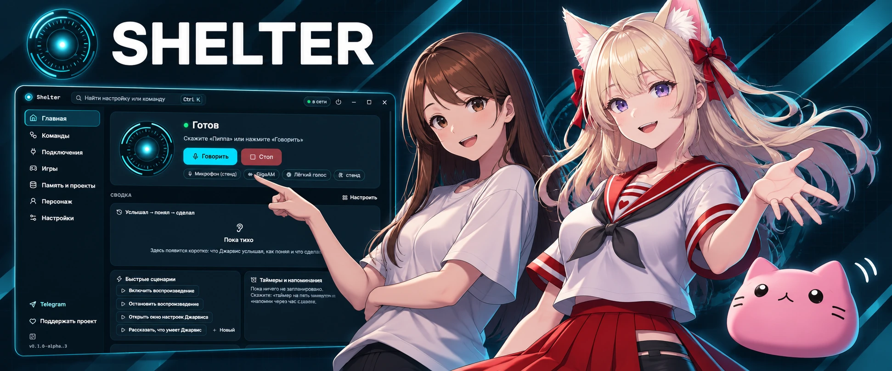
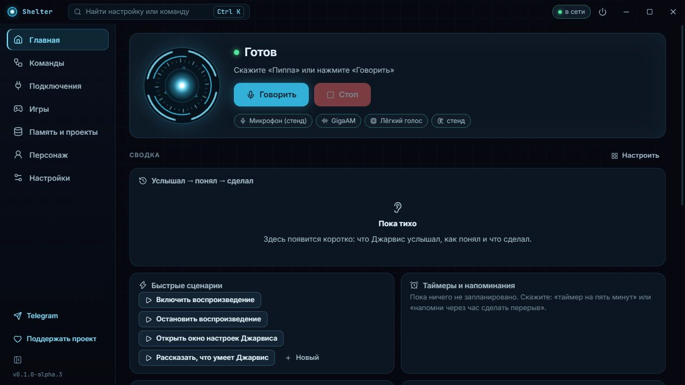
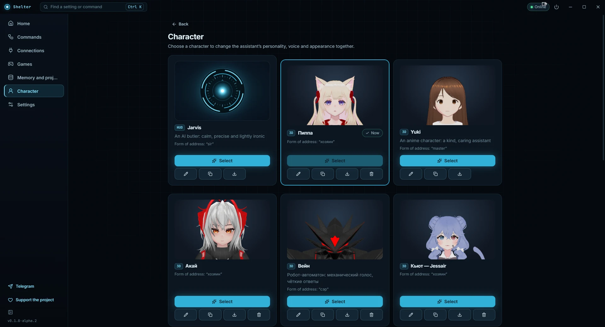
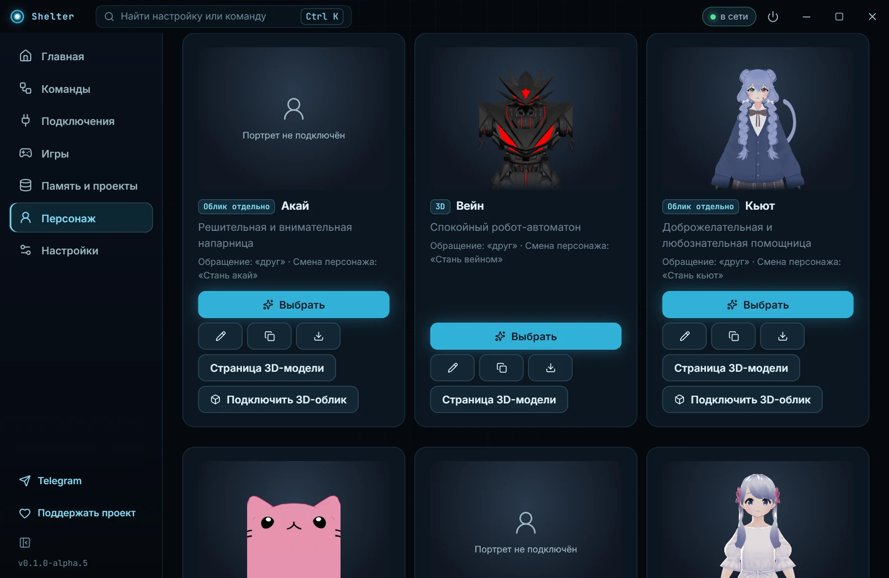

# Shelter

[English](../../README.md) · [Русский](../ru/README.md) · [日本語](../ja/README.md) · **简体中文**



Shelter 是一款适用于 Windows、Linux 和 Android 的开源语音助手。你可以启动应用、控制音乐、设置提醒、运行工作流，也可以与本地或云端模型聊天。在桌面端，用俄语说出当前角色的唤醒词，或点击 **Speak**（说话）。

[下载](https://github.com/IT-Shelter-Labs/shelter/releases) · [使用与开发指南](GUIDE.md) · [IT Shelter Telegram](https://t.me/+tqB8b6h4JbYwZWVi) · [支持项目](https://t.me/itshelter_bot?start=donate)

## 安装

| 平台 | 安装包 | 首次设置 |
| --- | --- | --- |
| **Windows 10/11 x64** | `Shelter-<version>-windows-x64-setup.exe` | 运行安装程序，按向导下载语音组件。 |
| **Linux x86_64** | `Shelter-<version>-linux-x86_64.tar.gz` | 解压后运行 `python3 tools/install_linux.py --light-recognition`。Linux 支持仍处于实验阶段。 |
| **Android 8 及以上** | **Shelter**（Companion APK） | 使用云端聊天，或与电脑上的 Shelter 配对。 |
| **Android 12 及以上** | **Shelter Local**（Local APK） | 还支持端侧聊天。兼容的模型权重可在应用内下载。 |

测试版 APK 使用调试密钥签名。模型权重需要单独下载。系统要求和首次启动步骤见[指南](GUIDE.md)。

## 主要功能

- **语音与文本。** 桌面端使用 GigaAM 或 Vosk 识别俄语语音，支持语音回复和中止当前请求。
- **电脑控制与工作流。** 启动应用、控制媒体和音量、编辑文本。工作流可通过按钮、语音、定时任务或事件触发。
- **模型与项目。** 可分别选择用于聊天、复杂任务、屏幕理解、语音合成和图像生成的模型。在应用内管理对话、记忆和项目资料。
- **游戏。** 在受支持的 Minecraft Java 版世界连接伙伴，查看 Factorio 手工制作任务的进度，或在《钢铁雄心 IV》中使用战役工具和屏幕分析。
- **集成。** 连接手机、智能家居、OBS、Telegram、MCP 和扩展。

应用界面支持俄语和英语。日语和简体中文用于文档。

## 桌面界面与角色



桌面端有十个角色预设。首次启动默认选中 **Jarvis**。其他角色包括 Pippa、Yuki、Akai、Vain、Manju、Tsukuyomi、Cute、Yamaneko 和 Miku。角色预设会更换唤醒词、声音和性格，更新后保留你的选择。





Shelter 自带 Yuki、Vain、Manju 和 Tsukuyomi 的 3D 外观。Pippa 的原版外观可从作者处下载，再通过角色卡导入。使用兼容的 NVIDIA 显卡时，角色语音设置会下载训练好的 Jarvis v4 配置，并为 Yuki 和 Pippa 使用内置声音样本。[角色设置](GUIDE.md) · [素材署名](THIRD_PARTY.md)

## 从源码构建

Windows 需要 Python 3.11、Node.js 22.12 或更高版本、Rust、MSVC Build Tools 和 WebView2。在仓库根目录打开 PowerShell，执行以下命令。

```powershell
python -m venv .venv
.\.venv\Scripts\python.exe -m pip install -r requirements-lock.windows.txt
$env:Path = "$(Resolve-Path .\.venv\Scripts);$env:Path"
npm --prefix app ci
npm --prefix app run desktop:build
```

启动 `app/src-tauri/target/release/Jarvis.exe`。为保持兼容性，可执行文件沿用原名。要构建 Windows 安装程序，请运行 `npm --prefix app run desktop:bundle`。

| 目录 | 内容 |
| --- | --- |
| `shelter_core/` | Python 核心，负责语音、模型、操作和集成 |
| `app/`、`native/`、`hud/` | Svelte 和 Tauri 桌面应用、原生音频模块及 Windows HUD |
| `android/` | 两种 Android 版本的 Kotlin 实现 |
| `personas/` | 内置角色预设和获准分发的素材 |
| `minecraft/`、`games/` | 游戏客户端、适配器和模组 |
| `tests/`、`tools/`、`docs/` | 测试、构建工具和文档 |

[构建、测试与贡献](GUIDE.md)

## 数据与许可证

本地语音识别在设备上运行。搜索、天气和云端模型等功能会向所选服务发送必要的请求。公开源码导出不会包含本地模型、语音样本、凭据或项目数据。

Shelter 代码采用 [MIT 许可证](../../LICENSE)。第三方组件和素材适用各自的条款。[第三方署名与许可证](THIRD_PARTY.md)
